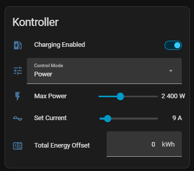
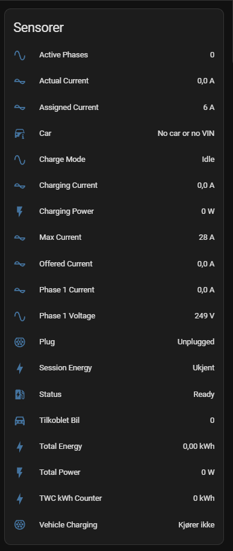
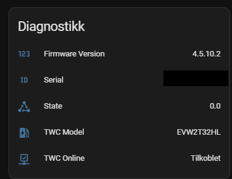
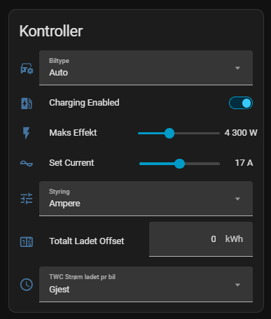
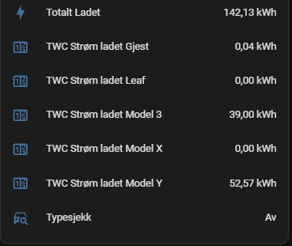

# TWC Controller (multi-charger fork)

An [ESPHome](https://esphome.io) external component that controls one to four **Tesla Wall Connector Gen2** units over
RS485. The ESP32 acts as the load-sharing master, and the Wall Connectors run as slaves (rotary switch on **F**).
Home Assistant gets one device per charger, with controls for current and power, and measurements of current, power
and energy.

> **Fork notice.** This is a fork of [jnicolson/esphome-twc-controller](https://github.com/jnicolson/esphome-twc-controller).
> The component has been rewritten (`components/twc_controller`, replacing the original `components/twc-controller`).
> It adds support for several chargers, a power mode, IT grids, car type detection and an energy counter.
> Licensed under GPL-3.0 like the original. Thanks to jnicolson for the original component, to WinterDragoness and Craig 128
> on the Tesla Motors Club forum for working out the protocol, and to the TWCManager projects (see [Links](#links)).

> ⚠ **Safety.** This controls how much current a car draws from your installation. `max_current` must never be higher
> than what your fuse and cable are rated for: the Wall Connector obeys whatever the master sends. Electrical work on
> the charger must be done by a qualified electrician. Use at your own risk.
>
> The RS485 bus has no authentication. Anything connected to it can pose as a Wall Connector: it can report false
> energy or a false VIN, or take a charger slot. The current sent is still capped by `max_current`. Keep the bus
> wiring inside the building.

## Contents

- [What it does](#what-it-does)
- [Home Assistant](#home-assistant)
- [Hardware](#hardware)
- [Installation](#installation)
- [Configuration](#configuration)
- [Grid types and power](#grid-types-and-power)
- [Car type on IT 3-phase](#car-type-on-it-3-phase)
- [Energy](#energy)
- [Several chargers](#several-chargers)
- [Bench test checklist](#bench-test-checklist)
- [Home Assistant: kWh per car](docs/home-assistant.md)
- [RS485 protocol notes](docs/TWC-RS485-Protocol.md)
- [Changes from the original](#changes-from-the-original)

## What it does

- **Set Current**: the current the car may draw, changed from HA, for example by a solar or tariff automation.
- **Charging Enabled**: starts or stops charging (`FCB1` / `FCB2`).
- **Several chargers** (1–4) on one bus share one main fuse. Each charger is its own HA device.
- **Power mode** (one or several chargers): you set the power in W, and each car gets the amps that give that power on
  its phase setup. With several chargers the power is split between the cars by priority.
- **kWh per car** in Home Assistant, also when several cars share one charger (by VIN, or a guest counter).
- **IT grids** (common in Norway): correct power and energy, even though the Wall Connector only measures one line there.
- **Car type**: from the VIN (Tesla), or measured with an optional circuit power meter for cars without a VIN.
- **Energy**: energy per session and a lifetime counter that you can use in the HA Energy dashboard, with an offset you can set.
- Measurements: voltage and current per phase, offered current, power, plug state, VIN, car model, serial, firmware and TWC model.

## Home Assistant

One charger with [`twc.yaml`](twc.yaml) on a `SINGLE_PHASE` grid (HA in Norwegian, so some states and card titles are
Norwegian):

<p>
  
  
  
</p>

An `IT_3PHASE` charger with the entity names in Norwegian, plus the kWh-per-car dropdown from
[docs/home-assistant.md](docs/home-assistant.md) (Biltype = Car Type, Maks Effekt = Max Power, Styring = Control Mode,
Totalt Ladet Offset = Total Energy Offset, "TWC Strøm ladet pr bil" = the Utility Meter tariff select), and the kWh per
car from that Utility Meter (Totalt Ladet = Total Energy, Typesjekk = Type Check):

<p>
  
  
</p>

## Hardware

Any ESP32 with an RS485 transceiver (for example a MAX485 or SP3485) works. Connect:

| ESP32 | RS485 transceiver |
|---|---|
| `tx_pin` | DI |
| `rx_pin` | RO |
| `flow_control_pin` | DE + /RE together |

Connect A/B to the Wall Connector's RS485 terminals (D+ / D−), and to every unit on the bus if you have several.
Put a 120 Ω termination at the ends of a long bus. Set the rotary switch on every Wall Connector to **F**. Its maximum
current is then set by this controller, not by the switch.

The original hardware design is at [jnicolson/TWCController](https://github.com/jnicolson/TWCController).
The examples use an ESP32-C3 with TX = GPIO6, RX = GPIO7 and DE/RE = GPIO8. Change the pins to match your board.

## Installation

1. Copy [`twc.yaml`](twc.yaml) (one charger) or [`twc-dual.yaml`](twc-dual.yaml) (two chargers) to your ESPHome config
   folder.
2. Put your secrets in `secrets.yaml`. [`secrets.example.yaml`](secrets.example.yaml) shows which ones are needed.
3. Set `max_current`, `grid_type` and the pins for your installation, then install.

The examples fetch the component from GitHub:

```yaml
external_components:
  - source: github://sigurdi/esphome-twc-controller@main
    components: [twc_controller]
```

If you prefer a local copy, copy `components/twc_controller/` into your ESPHome config folder and use
`source: {type: local, path: components}` instead.

Tested with ESPHome 2026.11, 2026.10 and 2026.4 (esp-idf) on an ESP32-C3, against Wall Connector Gen2 firmware 4.5.x.
The multi-charger example needs ESPHome 2025.8 or newer (2025.7 does not allow the same entity name on several devices).

## Configuration

Top-level options:

| Option | Default | Meaning |
|---|---|---|
| `flow_control_pin` | required | RS485 DE/RE pin |
| `grid_type` | required | `SINGLE_PHASE`, `TN_3PHASE` or `IT_3PHASE` (see below) |
| `max_current` | 16 | Main fuse / supply cable in A. The most all chargers **together** may draw |
| `min_current` | 6 | Have been problems below 6A, some cars refuse to restart without a re-plug |
| `set_current` | `min_current` | Start value of Set Current |
| `twc_id` | `0x7777` | The master's ID on the bus |
| `nominal_voltage` | 230 | Used until the Wall Connector reports a voltage |
| `phase_threshold` | 1.0 | A on a phase before it counts as in use |
| `stop_reassert_interval` | 5s | How often STOP is resent while the car still draws current |

Every entity is optional. Leave out the ones you do not need. See `twc.yaml` for the full list with names.
A few need explaining:

| Entity | Meaning |
|---|---|
| `current_limit` (Set Current) | The current you want, in A |
| `assigned_current` | What the charger actually got after the fuse and power split. 0 = paused |
| `offered_current` | What the Wall Connector says it offers the car |
| `actual_current` | What the car draws (L1, 0.01 A resolution) |
| `charge_mode` | For example `Idle`, `3-phase`, `1-phase IT (meter)`, `3-phase IT (3 sub-chargers)` |
| `car_type` | Select: `Auto`, or force `1-phase` / `3-phase` / `2 sub-chargers` |
| `type_check` | On while the quick car type check runs (see below) |

`car_type` and `type_check` are only made on `IT_3PHASE`, and `phase_2_*` / `phase_3_*` only on `TN_3PHASE`. On other
grids they are skipped (the config log says so), so the same entity list can be used everywhere.

Power control works with one charger too: add `multi_charger:` with `control_mode`, `max_power` and `total_power` but
no `chargers:` (see `twc.yaml`).
| `plug_state` | Unplugged / Charging / Plugged in, not charging / Error (firmware 4.5.3+) |
| `session_energy` | kWh since the car was plugged in |
| `total_energy` + `energy_offset` | Lifetime kWh counter (see [Energy](#energy)) |

## Grid types and power

| `grid_type` | Wiring | What the Wall Connector measures | Power |
|---|---|---|---|
| `SINGLE_PHASE` | 230 V, L + N (TN) or L1 + L2 (IT) | L1 | V × I |
| `TN_3PHASE` | 400 V TN: L1, L2, L3 + N | all three phases | Σ V × I per phase |
| `IT_3PHASE` | 230 V IT: Wall Connector L1 = L1, L2 = L2, **N = L3**, Wall Connector L3 not used | **only L1** | depends on the car, see below |

On a 230 V IT grid, a Tesla on-board charger has 2 or 3 "sub-chargers", each connected between two of the three lines.
The Wall Connector only sees the current on one line, so the power has to come from what kind of car it is:

| Car | Power on IT 3-phase |
|---|---|
| 3 sub-chargers (Model 3, Y, S/X from 2021, most other cars charging on 3 phases) | √3 × V × I |
| 2 sub-chargers (Model S/X before 2021) | 1.15 × V × offered current (measured) |
| 1-phase car | V × I |

## Car type on IT 3-phase

The car type is taken from the first source that gives an answer:

1. **`car_type` select**, if it is not `Auto`.
2. **VIN** (Tesla only): the model and model year in the VIN.
3. **Measured**: from the checks below.
4. **Assumed 3-phase.**

Without a circuit meter there is an **L1 check** for Model S/X: if L1 stays under 75 % of the offered current for 60 s,
the car uses 2 sub-chargers.

With a **circuit meter** (`multi_charger: circuit_power:`, a Home Assistant sensor in W for the circuit the chargers are
on), cars without a VIN can be measured. When the charging current changes by ΔI, the circuit power changes by
about V × ΔI for a 1-phase car and √3 × V × ΔI for a 3-phase car.

- **Quick type check** (car without a VIN, `car_type` = Auto):
  - The first measurement is the charge start (0 → I).
  - Then the controller steps the current 4 A (down when possible, otherwise up within the fuse) for about 40 s and back.
  - Each measurement compares the circuit 30 s before the step with 10–40 s after it.
  - Two equal results set the type, which takes about 1.5 minutes.
  - If the meter is too noisy (for example a heat pump starts), it retries after 5 minutes, up to 3 times.
  - `type_check` is on while it runs, so that HA automations that change the current can wait.
- **Passive meter check**: any current change of 3 A or more is compared the same way.

The meter must report W, not kW, and should update at least every 5–10 s for the quick check.
[`tools/meter_sim.py`](tools/meter_sim.py) runs the detection logic on test cases.
For example the Tibber Pulse total power, or an inverter's UPS load output when the charger is connected to it.

## Energy

The Wall Connector's own kWh counter (`total_kwh_delivered`) has two problems:

- On IT 3-phase it only counts V1 × I1, so it is about √3 too low for a 3-phase car.
- After some firmware updates its value is a random large number.

So the component keeps its own counter:

- **`session_energy`**: on IT 3-phase it integrates the power calculated above. Elsewhere it counts the steps of the
  Wall Connector's counter since the car was plugged in.
- **`total_energy`**: lifetime counter from the same sources.
  - It is saved in flash every whole kWh and at the end of each session.
  - `energy_offset` (kWh, set in HA) is added to it. Use the offset once to start the counter at what the charger had
    delivered before.
  - Do not lower the offset later: HA treats a lower value as a meter reset.
  - Use `total_energy` in the HA Energy dashboard.
  - The counters are stored by charger position in the YAML. If you change the order of `chargers:`, the counters
    swap too.

To track kWh per car in Home Assistant (by VIN, or a guest counter), also with one charger shared by several cars, see [docs/home-assistant.md](docs/home-assistant.md).

## Several chargers

Only tested with one charger plus a second one on the bench; the multi-charger logic is mostly tested in simulation.
Feedback is welcome.

Up to 4 Wall Connectors can share one RS485 bus. They share **one main fuse**: `max_current` is the limit for all of them
together, and a charger alone may use all of it. Write the entity names once at the top level. They are created for each
charger on its own HA device (`devices:` in `esphome:`). See [`twc-dual.yaml`](twc-dual.yaml).

| `multi_charger:` key | Meaning |
|---|---|
| `chargers:` | The chargers in priority order. Each has a `device_id`, an optional `slave_id` (pin to one unit; the ID is in the log line `Found TWC xxxx`) and an optional `set_current` |
| `total_current` | Lower the shared limit at runtime, for example for solar |
| `control_mode` | **Current**: the Set Current values decide. **Power**: Max Power decides |
| `max_power` | W for all cars together. The range is what `max_current` gives on your grid |
| `priority` | % of the power for charger 1. The others share the rest. 50 = equal for two chargers |
| `total_power` | Sum of all chargers' power |
| `circuit_power` | Optional HA power sensor for car type detection |

**Current mode**:
- Each charger gets the lower of its Set Current and what is left of the fuse.
- The last charger has no Set Current and gets the rest.
- A charger with less than `min_current` left is paused (0 A and STOP) and started again when there is room.

**Power mode**:
- Max Power is split by priority.
- Each car gets amps = its share of the power ÷ watts per amp for that car. The voltage used is the measured voltage,
  averaged over about 3 minutes.
- A car below 6 A is raised to 6 A, paid from the others. If not even all cars fit at 6 A, the lowest priority car
  is paused.
- A charger with no car, or with a full car, keeps 6 A so a car can start, but gets no share.
- The fuse limit still applies on top.

## Bench test checklist

Set `logger: level: VERBOSE` to see every frame.

1. **Link**: the log shows `Found TWC xxxx ... protocol 2`, and `TWC Online` turns on.
2. **Errors**: a few `Bad frame` lines at boot are normal. A steady stream means a problem with the wiring, the
   termination or the DE pin.
3. **Current**: change Set Current while charging. Offered Current follows within 1–2 s and Actual Current within about 10 s.
4. **Stop / start**: turn Charging Enabled off and on. Note what the car does. Some cars ask for a re-plug after a STOP.
   Tested OK on Model X 2017, Model 3 2021, Model Y 2025, Mercedes eVito 2026 and Nissan Leaf 2018: charging starts
   again quickly, and the car app shows "charging stopped" while it is stopped.
5. **Restart the ESP** while charging. The car should go on charging, or resume within about 10 s.
6. **Pull the RS485 cable** for 40 s. The Wall Connector stops the car on its own, which is expected. When you reconnect,
   the link comes back.

[`tools/`](tools) has small scripts that use the ESPHome API to read states, follow the log and set a value
(`pip install aioesphomeapi`, then set the API key in the `TWC_API_KEY` environment variable).

## Changes from the original

| Original | Effect | Now |
|---|---|---|
| Checksum included an uninitialised byte | Random bad frames, depending on the compiler | Checksum over the body only |
| Sending from a separate task while `loop()` reads the same UART | Collisions, rare crashes | Everything in `loop()` |
| No check that the bus is idle before sending | Talked over the slave's reply | Sends only after 25 ms of silence on the bus |
| Blocking read on the SLIP escape byte | Stalled loop, lost bytes | Non-blocking parser that resyncs |
| Current limit sent only once | Car stuck at 6 A after a boot | Limit sent at boot, on change, when the slave asks, and every 30 s |
| Currents rounded to whole amps | 0.5 A steps lost | 0.01 A resolution |
| Null pointer if a heartbeat came before linkready | Reboot loop | Slave adopted from its heartbeat |
| Dangerous commands only partly blocked | Risk of bricking (OTP write) | `FC19`, `FC1A`, `FBE8`, `FCEA`, `FCE5`, `FCA1`, `FBA4` are never sent |
| One charger | — | 1–4 chargers, shared fuse, power mode, IT support, car type detection, energy counter, VIN debounce |

Like upstream, it discards serial and VIN fields that are not plain ASCII.

## Links

- [jnicolson/esphome-twc-controller](https://github.com/jnicolson/esphome-twc-controller): the original component
- [craigpeacock/TWC](https://github.com/craigpeacock/TWC)
- [ngardiner/TWCManager](https://github.com/ngardiner/TWCManager)
- [dracoventions/TWCManager](https://github.com/dracoventions/TWCManager) (original)

## License

GPL-3.0, see [LICENSE](LICENSE).
